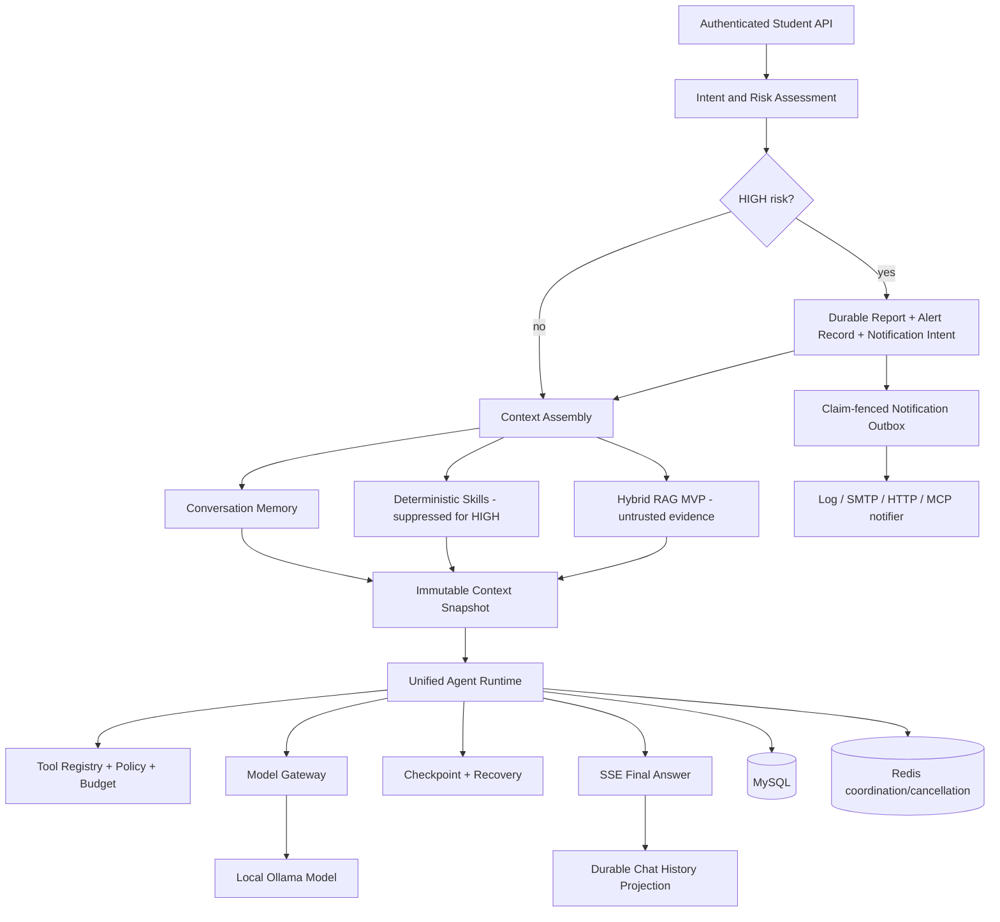

# multimodalAgent

`multimodalAgent` is a Campus Mental Health Multimodal Agent implemented with Java and Spring Boot.
It provides supportive campus information and a demonstrable durable Agent Runtime: authenticated
chat, multimodal risk fusion, bounded conversation memory, deterministic Skills, Hybrid RAG,
governed tools, immutable execution snapshots, crash recovery and a reliable high-risk notification
Outbox.

This is an educational software assistant. It does **not** diagnose conditions, replace medical or
psychological professionals, or provide a clinical safety guarantee. High-risk classification and
notification are software-assisted workflows; a real deployment requires reviewed emergency policy,
trained staff, secured recipients and operational monitoring.

## Architecture



Important trust and ordering rules:

- CHAT requests do not retrieve knowledge. CONSULT and HIGH-risk requests may retrieve.
- HIGH-risk report and notification intent are committed before retrieval begins.
- Notification delivery is independent of the asynchronous Excel ledger write.
- External RAG and multimodal text is encoded as non-authoritative
  `UNTRUSTED_EVIDENCE_DATA_V1`, never promoted to SYSTEM instructions.
- HIGH-risk multimodal decisions suppress ordinary Skill context using a trusted server decision.
- Recovery restores the original snapshots/checkpoints; it does not re-retrieve historical evidence
  or repeat admission and safety side effects.

## Technology

- Java 17, Spring Boot 3, WebFlux, Spring Security and Spring Data JPA
- Spring AI with Ollama/OpenAI-compatible model adapters
- MySQL 8, Redis 7 and Flyway migrations
- Unified durable Agent Runtime with budgets, Tool Registry, policy engine and event stream
- Configuration/context snapshots, leases, checkpoints and startup Recovery
- BM25, persisted dense cosine retrieval and exact Reciprocal Rank Fusion (`k=60`)
- SSE streaming, Testcontainers, JUnit 5 and Maven

## Quick Start — verified Docker demo

Prerequisites: Docker Desktop, Java 17/Maven for tests, and Ollama listening on
`127.0.0.1:11434` with `mindbridge-qwen2.5-7b-ft:latest` registered.

```powershell
ollama list
docker compose up -d --build mysql redis app
docker compose ps
Invoke-RestMethod http://localhost:8080/actuator/health
```

The default Compose topology is an explicitly local demo: MySQL + Redis + application, unified
Runtime enabled, Hybrid RAG MVP enabled, `USE_CHROMA=false`, local Excel output and log-only
notification delivery. It does not start the legacy Chroma adapter or Mailpit.

Open `http://localhost:8080` or verify the model configuration:

```powershell
curl.exe -u student:student123 http://localhost:8080/api/agent/status
```

Stop the demo without deleting data:

```powershell
docker compose down
```

The Compose database passwords and `admin/admin123`, `student/student123` are development-only
fixtures. Do not expose this configuration publicly or reuse these credentials in production.

### Local script

On a Unix-like shell, `./scripts/run-dev.sh` verifies/starts Ollama and launches the same MVP mode:

- `AGENT_RUNTIME_ENABLED=true`
- `AGENT_CHAT_MIGRATION_ENABLED=true`
- `AGENT_MEMORY_ENABLED=true`
- `AGENT_SKILLS_ENABLED=true`
- `RAG_HYBRID_MVP_ENABLED=true`
- `RAG_RETRIEVAL_MODE=HYBRID_RRF`
- `USE_CHROMA=false`
- `AI_PROVIDER=ollama`
- `OLLAMA_MODEL=mindbridge-qwen2.5-7b-ft:latest`

Environment variables override each value. See [the demo guide](docs/p13/demo-guide.md) for manual
Windows startup, rollback and troubleshooting.

## Demo Scenarios

All chat calls use the authenticated student endpoint and return SSE.

```powershell
# Ordinary CHAT: no RAG
curl.exe -N -u student:student123 -H "Content-Type: application/json" `
  -d '{"message":"你好，请介绍一下你能做什么"}' `
  http://localhost:8080/api/chat/stream

# Sleep Skill + CONSULT retrieval
curl.exe -N -u student:student123 -H "Content-Type: application/json" `
  -d '{"message":"最近总是睡不着，怎样调整作息？"}' `
  http://localhost:8080/api/chat/stream

# Academic-pressure Skill
curl.exe -N -u student:student123 -H "Content-Type: application/json" `
  -d '{"message":"考试和论文堆在一起，我压力很大"}' `
  http://localhost:8080/api/chat/stream

# Interpersonal Skill
curl.exe -N -u student:student123 -H "Content-Type: application/json" `
  -d '{"message":"我和室友发生冲突，不知道怎么沟通"}' `
  http://localhost:8080/api/chat/stream
```

The first SSE `meta` event contains `sessionId`. Send it in the next request to demonstrate durable
two-turn memory:

```json
{"sessionId":"<meta-sessionId>","message":"请结合我刚才的情况继续给建议"}
```

HIGH-risk demonstration:

```powershell
curl.exe -N -u student:student123 -H "Content-Type: application/json" `
  -d '{"message":"我不想活了，感觉马上会伤害自己"}' `
  http://localhost:8080/api/chat/stream

curl.exe -u admin:admin123 http://localhost:8080/api/admin/reports
curl.exe -u admin:admin123 http://localhost:8080/api/admin/alerts
```

The report, AlertRecord and notification intent are persisted in one transaction before optional
retrieval. The claim-fenced Outbox performs delivery independently from Excel reporting.

## Hybrid RAG MVP

Administrator-maintained public-campus documents can be ingested through:

```powershell
curl.exe -u admin:admin123 -H "Content-Type: application/json" `
  -d '{"source":"sleep-guide.md","content":"保持固定起床时间，睡前减少咖啡因和屏幕刺激。"}' `
  http://localhost:8080/api/admin/knowledge
```

Student conversations and private memory are not inserted into the shared index. Three independently
tested modes are available through `RAG_RETRIEVAL_MODE`:

- `BM25_ONLY`: NFKC normalization, Chinese Han unigram/bigram tokens, BM25 `k1=1.2`, `b=0.75`.
- `DENSE_ONLY`: cosine ranking over persisted, model/dimension-bound embeddings.
- `HYBRID_RRF`: exact `sum(1/(60+rank))`, stable tie-breaking and deduplication.

Without an embedding API key, the demo cannot create/query real dense vectors. Hybrid requests then
report `LEXICAL_ONLY_DEGRADED`; this is expected and is not presented as Hybrid success. The 30-case
offline benchmark uses deterministic fixture embeddings. The real-model demonstration uses the local
LLM plus fixture embeddings; neither result is a real-embedding benchmark.

To reproduce the legacy rollback path:

```powershell
$env:RAG_HYBRID_MVP_ENABLED="false"
```

The old Chroma v1 adapter is not part of the MVP. It can be started only for compatibility work with
`docker compose --profile legacy-chroma up -d chroma`; `USE_CHROMA=false` remains the demo default.

## Verification

```powershell
mvn clean test
mvn -P real-model "-Dtest=HybridRagRealModelDemoTest" test
docker compose config
```

Default Maven tests are offline except for explicit Testcontainers suites. Real-model tests are
opt-in and skip rather than fabricate success when Ollama/model prerequisites are missing.

## Technical Highlights

1. Durable Agent Runtime with one governed model/tool loop, execution budgets and deterministic
   event/persistence semantics.
2. Typed tool contracts, validation, policy enforcement, idempotency/reconciliation evidence and
   reliable outcome recovery.
3. Content-addressed configuration/context snapshots plus checkpoint-based same-run recovery without
   duplicate admission or completed-tool execution.
4. Deterministic Context Assembly combining isolated memory, versioned Skills, trusted policy and
   provenance-bound untrusted evidence.
5. Bounded Hybrid RAG MVP with real BM25 and dense branches, exact RRF, truthful degradation and a
   deterministic 30-query evaluation suite.
6. Transactional high-risk facts and a durable, retryable, claim-fenced notification Outbox that is
   independent of Excel reporting.

## Safety and Deployment Notes

- API keys and service passwords are environment variables and must not be committed.
- H2 Console is disabled by default. It may be enabled only for isolated local debugging with
  `H2_CONSOLE_ENABLED=true`.
- Log notification mode records only durable identifiers, not student text, assessment summaries or
  recipients.
- Synthetic retrieval fixtures contain no real student records.
- SMTP recipients and emergency language must be reviewed for the deploying institution.

## Limitations

This release is a small, demonstrable MVP—not the complete production knowledge platform proposed by
ADR-027. [ADR-028](docs/adr/ADR-028-p12-hybrid-rag-mvp.md) records the accepted boundary.

Deferred capabilities include production multi-tenant knowledge ACLs, immutable Knowledge
Generations and CAS publication, Chroma v2 publication, revocation/citation control-plane semantics,
production-scale retrieval performance validation and clinical-grade safety guarantees.

See [P13 architecture](docs/p13/architecture.md), [demo guide](docs/p13/demo-guide.md), and the
[final delivery report](docs/p13/final-delivery-report.md).
