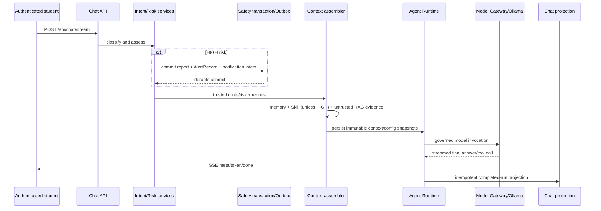

# P13 MVP Architecture

## End-to-end request chain

## Component responsibilities

| Component | Delivered responsibility |
| --- | --- |
| Chat API | Authenticated student-only SSE entry; session ownership checks. |
| Risk/multimodal fusion | Server-owned route and HIGH-risk decision. |
| Safety transaction | Persists report, AlertRecord and recipient intent before retrieval. |
| Context Assembly | Orders isolated memory, trusted policy, Skills and untrusted evidence. |
| Hybrid RAG MVP | BM25, persisted dense cosine, exact RRF, bounded index and truthful degradation. |
| Agent Runtime | One iteration/tool loop with budgets, middleware, events and durable state. |
| Tool Governance | Typed arguments, validation, allowlist/policy and recovery contract. |
| Snapshots/Recovery | Content-addressed config/context plus same-run checkpoint resume. |
| Notification Outbox | Durable claims, retry classification, lease recovery and claim fencing. |
| MySQL/Redis | Durable business/runtime truth; distributed leases and cancellation transport. |
| Ollama | Local OpenAI-compatible streaming model provider. |

## Trust boundaries

- Risk, authenticated identity, recipient configuration and Skill suppression are server-owned.
- RAG and multimodal evidence remains an ASSISTANT-role data envelope with provenance; it cannot
  become trusted SYSTEM policy.
- Shared retrieval accepts only administrator-maintained or bundled public-campus material.
- Recovery consumes frozen snapshots/checkpoints and durable tool outcomes. It does not silently
  substitute current knowledge for historical evidence.

## Delivery boundary

This diagram describes the released MVP. It does not imply production knowledge ACLs, immutable
Knowledge Generations, Chroma v2 publication, clinical certification or a production latency SLO.
Those limitations are normative in [ADR-028](../adr/ADR-028-p12-hybrid-rag-mvp.md).
